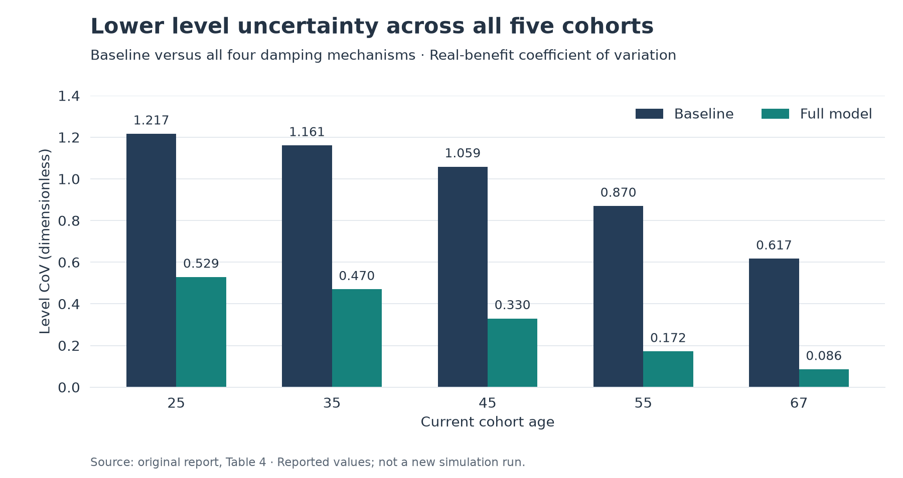
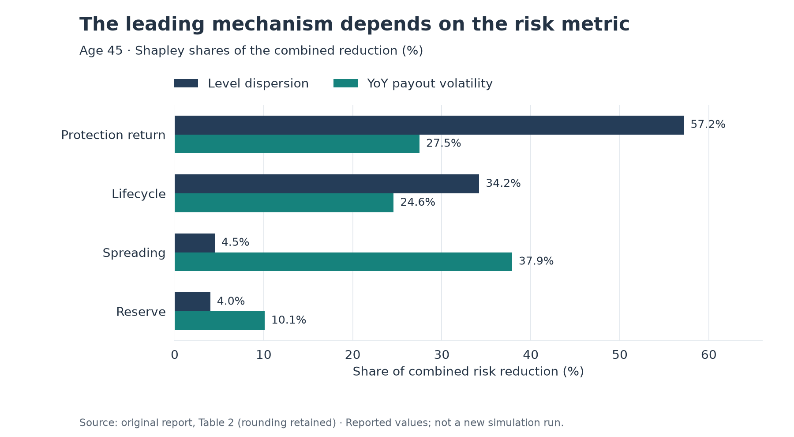
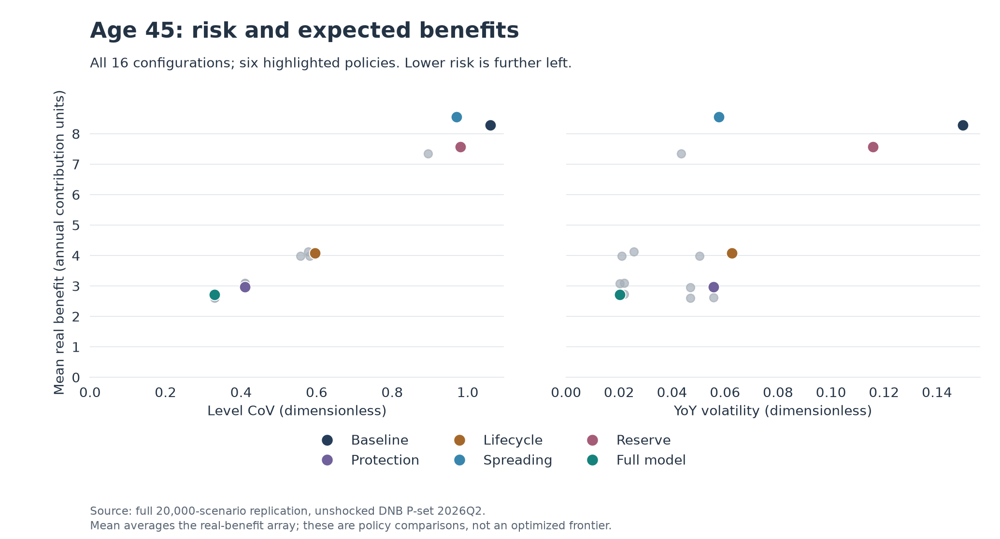

# Pension Risk Damping under the Dutch Wtp

**Which mechanisms in the solidarity-based contribution scheme reduce volatility
in pension outcomes, and how much does each contribute individually and jointly?**

Pim van den Bos · University of Twente · *Management Control for Financial Institutions*
· Academic research, July 2026

The Dutch *Wet toekomst pensioenen* (Wtp) links pension outcomes more directly to
investment performance. In the *solidaire premieregeling* (SPR), collective investment
and age-dependent return allocation create several ways to dampen risk. This study
examines which mechanisms reduce uncertainty in the pension **level**, and which
stabilize annual **payments during retirement**. Those objectives lead to different
answers and matter for pension policy, risk allocation and participant communication.

**Methods:** stochastic scenario analysis using DNB's 20,000 annual P-scenarios over
100 years (2026Q2); nominal and Dutch real yield-curve reconstruction; cohort/lifecycle
modeling; all 16 on/off combinations of four mechanisms; full-factorial Shapley
attribution. DNB generated the economic scenarios; this project models pension
outcomes conditional on them.

## Main findings from the report

The combined model reduces level CoV by **56.5%-86.1%** across the five cohorts.
Protection return and lifecycle dominate reduction in long-term level uncertainty.
For annual payout stability, **spreading has the largest Shapley contribution**.

| Current age | Baseline level CoV | Full model level CoV | Reported reduction |
| --- | ---: | ---: | ---: |
| 25 | 1.217 | 0.529 | 56.5% |
| 35 | 1.161 | 0.470 | 59.5% |
| 45 | 1.059 | 0.330 | 68.8% |
| 55 | 0.870 | 0.172 | 80.2% |
| 67 | 0.617 | 0.086 | 86.1% |



At age 45, protection and lifecycle receive **57.2%** and **34.2%** of the combined
level-dispersion reduction. Spreading receives **37.9%** of the combined YoY-volatility
reduction. These are contribution shares, not standalone percentage risk reductions.



The mechanisms interact: protection and lifecycle partly substitute for each other,
while spreading smooths the residual payout shock. Shapley averages marginal
contributions across coalition orderings. It removes attribution dependence on the
addition order, while retaining the simulator's fixed within-year operation order.
Published rounded shares are preserved, even when they do not sum to exactly 100%.

Stability also changes expected benefits. At age 45, the reported mean real benefit
is 8.2928 contribution units in the all-equity baseline, 2.9729 with standalone
protection and 4.0731 with standalone lifecycle (Table 1). The reserve is a single-person
buffer proxy and cannot quantify actual transfers between generations.

**Evidence status:** these charts and headline values visualize the supplied report,
and remain labeled as report-data figures. All four published tables are available
as [small CSV files with references and units](results/reported/README.md).

## Full-data replication and engineering audit

The complete **20,000-scenario** workflow has now run successfully: five cohorts,
all 16 coalitions, both risk metrics, all seven appendix tables and the separate
projection/longevity examples. **All 93 numerical outcome cells in the report's four
tables reproduce at their published rounding**, without recalibration or changes to
the research model. All 13 recovered notebook cells also executed on the full input.
Notebook/package agreement, 400 DNB reference-curve yields, path invariants and an
independent 24-ordering Shapley calculation were checked.

The [audit report](docs/replication_audit.md) and [compact replication snapshot](results/replication/2026q2/README.md)
provide the evidence, hashes and limitations. Additional diagnostics distinguish
expected benefits, level uncertainty and retirement-payment stability:



The reproduced age-45 full model has **0.020247 YoY volatility** versus **0.149754**
for the baseline (86.480% lower), and mean real benefit **2.722264** versus **8.292754**.
These are new replicated calculations, distinct from the original report tables.
Three coalition additions slightly increase level CoV despite positive overall
Shapley contributions. With the hedge fixed at 100% during payout, lifecycle changes
accumulated capital but adds no further relative-payout stabilization in those
coalitions. The audit explains both effects and includes
[scenario-distribution and scenario-count figures](docs/replication_audit.md).

## Explore the work

| Start here | Contents |
| --- | --- |
| [Research report](reports/Management_Control_Assignment.pdf) | 34-page portfolio edition; original research pagination retained |
| [Methodology](docs/methodology.md) | Equations, exact timing, assumptions, metric definitions and interpretation |
| [Reconstructed appendix notebook](notebooks/appendix_reconstructed.ipynb) | Every section A.1-A.13, including independent standalone functions, both engines and extensions |
| [Practical Python package](src/pension_risk/) | Shared implementation for data/curves, engines, metrics, Shapley and tables |
| [Code provenance](docs/code_provenance.md) | Section-to-function map, transcription repairs and engineering adaptations |
| [Data acquisition and provenance](docs/data_provenance.md) | Exact release, actual checksum, layout, cache policy and DNB attribution |
| [Execution status](docs/execution_status.md) | Checks actually completed and limits on reproducibility claims |
| [Full-data audit](docs/replication_audit.md) | Cell-level replication, factorial interactions, numerical diagnostics and economic model review |

The notebook is **reconstructed from the PDF**, not the unavailable original notebook.
The package removes repeated bookkeeping while preserving the printed mechanisms.
Projection-return and longevity examples remain separate from the four-player analysis.

## Install and run

Use Python **3.12**. From a clone of this repository:

```bash
python -m venv .venv
```

Activate it with `.venv\Scripts\Activate.ps1` in Windows PowerShell, or
`source .venv/bin/activate` on macOS/Linux. Then:

```bash
python -m pip install -r requirements-lock.txt
python -m pip install --no-deps -e .
python -m pytest -q
```

The lock pins the tested dependencies. The project metadata also supports
`python -m pip install -e ".[dev]"` when an unpinned development install is preferred.

### Regenerate the report-data figures (no large download)

```bash
python scripts/plot_reported_results.py
```

This reads only `results/reported/` and writes compact SVG and PNG figures to
`assets/figures/`. It runs no simulator.

### Optional DNB data and a small execution demonstration

```bash
python scripts/download_data.py
pension-risk analyze --scenarios 256 --extensions
```

The explicit optional download is **179 MB** (170.8 MiB): the unshocked **CP2022 P
scenarioset 20K 2026Q2**, released 14 April 2026. Raw data and parsed caches are
Git-ignored. The first run parses Excel with pandas/calamine; later runs use a
source-hash-bound NPZ cache. Downloads never happen on import or during tests.

For an existing manual download, supply a local path:

```bash
pension-risk analyze --workbook "data/raw/cp2022-p-scenarioset-20k-2026q2.xlsx" --scenarios 256 --extensions
```

The loader accepts another local directory/filename and checks the exact workbook's
SHA-256. [Manual acquisition instructions](docs/data_provenance.md) link directly to
DNB. **Subset outputs are demonstrations, not the published estimates.** New output
goes to `results/generated/demonstration_first_256/`, with data/parameter/implementation
provenance. Supplied report CSVs are never overwritten by this workflow.

### Full research workflow (explicit, computationally heavier)

```bash
pension-risk analyze --full --extensions
```

This selects all 20,000 input scenarios, five cohorts and 16 coalitions, generates all
seven appendix result tables for both risk metrics, and runs the separate A.8/A.9
examples. Coalition summaries are reused across metrics/tables and saved with their
provenance under `results/generated/full_research_run/`. A full run is not needed
for CI or for regenerating the report-data charts.

For the full engineering audit and additional figures:

```bash
python scripts/audit_replication.py
python scripts/plot_replicated_results.py
```

The audit executes the complete recovered notebook and checks it against the full
package run. Its new outputs default to the ignored generated-results folder.
`plot_replicated_results.py` regenerates the three extra figures from the committed
replication snapshot without a data download. See the audit documentation for
explicit snapshot-refresh commands.

For notebooks, select this environment's Python kernel. The reconstructed notebook
defaults to 256 scenarios; `PENSION_SCENARIOS=all` opts into the full input, and
`PENSION_WORKBOOK` configures its input path. Run its A.1-A.13 cells in order.
Its retained stepwise code repeats simulations, so use the package for practical runs.

## Understanding the two metrics

- **Level dispersion:** for each payout year, standard deviation of real benefit
  across scenarios divided by its mean; then take the median across payout years.
- **YoY volatility:** relative year-on-year real-benefit changes; standard deviation
  across payout years within each scenario; then the median across scenarios.

Both use population standard deviations (`ddof=0`). The appendix's mean and standard
deviation descriptives aggregate the entire real-benefit array, so their ratio need
not equal the level statistic above. Reported YoY volatility is broadly similar across
cohorts; the code computes it separately rather than forcing equality.

## Scope and execution status

The model uses entry age 25, retirement 68, a fixed age-95 horizon, flat nominal
contributions of 1.0 before returns and a 3% projection return over 27 payout years.
Its stylized 100%-equity baseline, illustrative hedge/lifecycle policies, single-bond
hedge, participant-level reserve, one scenario vintage and fixed operation order
bound its interpretation. The lifecycle falls to 20% at age 95, not retirement.
Five-year spreading includes the current shock slice immediately. Mortality appears
only in the separate illustration. This is an academic simulation study, not a
production pension calculator or official DNB implementation.

Completed: clean pinned installation, software tests, full 20,000-scenario calculations,
all 13 notebook cells on the full input, comparison of all 93 reported numerical cells,
curve/Shapley/path diagnostics and three additional figures. See
[execution status](docs/execution_status.md) for exact checks. Reproduction is established
for this fixed model and dataset; economic assumptions and real-world policy suitability
remain subject to model risk. No independent external study or production ALM validation
is claimed.

## Attribution

Research: **Pim van den Bos**, Department of IEBIS, University of Twente, Management
Control for Financial Institutions. Cite the research report when using its findings
([citation metadata](CITATION.cff)).

Economic scenarios: **De Nederlandsche Bank**, with [separate data reuse terms and
attribution](docs/data_provenance.md). Code is available under the [MIT license](LICENSE),
whose scope excludes the report, transcribed research tables/figures and DNB data.
