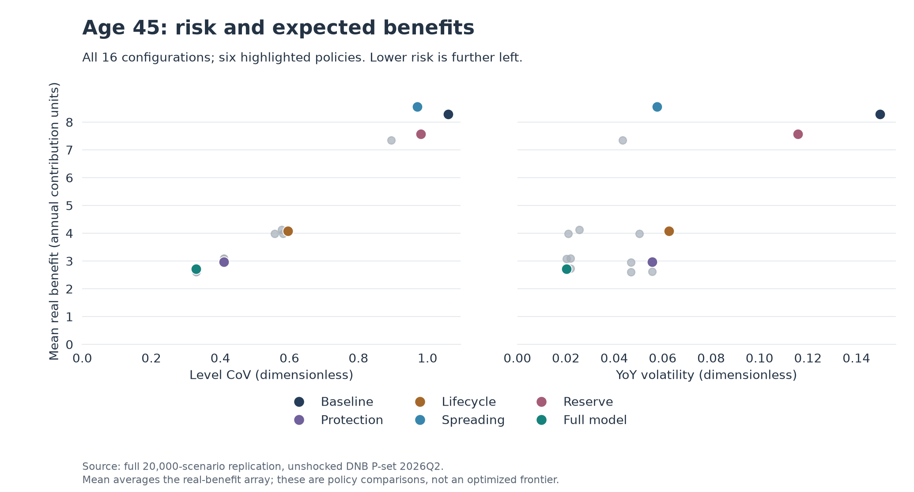
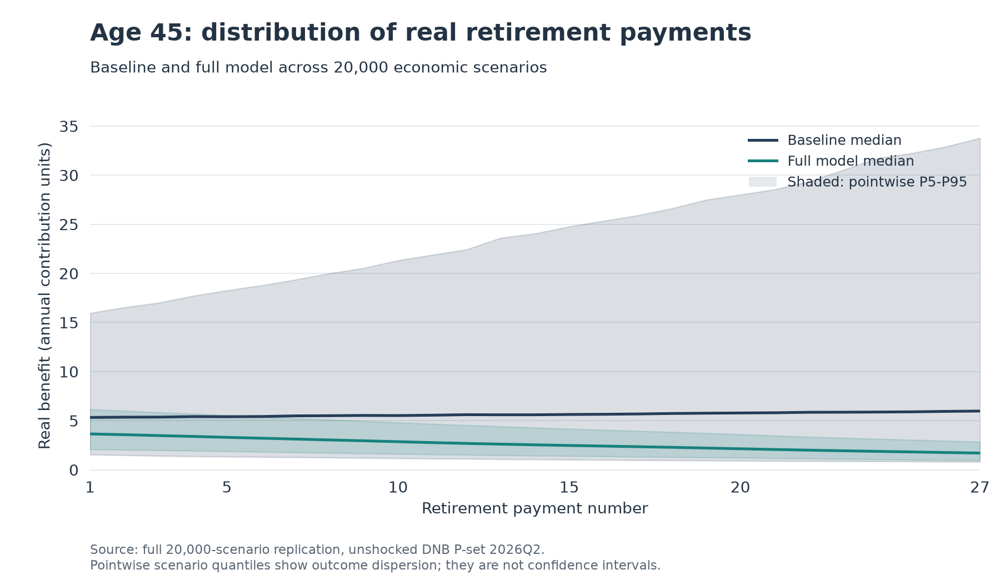
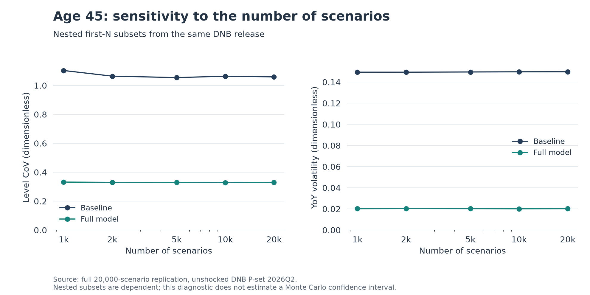

# Full-data replication and engineering audit

On 6 November 2026, the recovered model was run on **all 20,000 scenarios**, all
five cohorts and all 16 coalitions of the exact unshocked DNB CP2022 P-set 2026Q2.
**All 93 numerical outcome cells in Section 6 Tables 1-4 match the report at its
published rounding.** No mechanism, parameter or reported table was changed to obtain
agreement. The projection and illustrative-longevity extensions also ran.

This establishes numerical reproduction of the supplied report from its reconstructed
appendix. It is not external validation of the DNB generator, a real pension fund's
policy, or the model's economic assumptions. The original notebook remains unavailable.
The package and recovered notebook share the same source document and input data.

## Evidence and reproducible commands

The [committed replication snapshot](../results/replication/2026q2/README.md) contains
unrounded coalition summaries, all seven appendix tables, cell-level report comparisons,
curve checks, path checks, Shapley diagnostics, scenario-count diagnostics and provenance.
The original [reported results](../results/reported/README.md) remain separate and unchanged.
The notebook contains no prefilled outputs; execution evidence is recorded in the audit.

```bash
pension-risk analyze --full --extensions
python scripts/audit_replication.py
python scripts/plot_replicated_results.py
```

The first two commands require the optional DNB workbook and the development
dependencies. The audit defaults to the ignored `results/generated/full_research_audit/`.
To intentionally create a compact, reviewable snapshot, use:

```bash
python scripts/audit_replication.py --output results/replication/2026q2
```

The figure script reads the committed summaries and requires no workbook. It can read
a fresh audit with `--input results/generated/full_research_audit`. Run commands from
the repository root. The full calculation records source/data identities, parameters,
dependency versions, completion times and elapsed time. The audit records file hashes
for its code, input report, supplied tables and numerical outputs. Code/notebook source
hashes normalize text newlines to LF; data/report/output hashes remain hashes of raw
bytes. Generated snapshot text is written with LF. This makes the source identity
portable across Windows and Linux without changing the executed code. Content hashes
identify the exact audited source. The public report is the portfolio edition, with
original research pagination retained; its current file hash is recorded separately.

## Numerical checks

| Check | Scope and result |
| --- | --- |
| Report Table 1 | 24 available numerical outcome cells; all match printed precision |
| Report Table 2 | 24 Shapley shares; all match, without normalizing rounded totals |
| Report Table 3 | 25 cohort/standalone CoVs; all match |
| Report Table 4 | 20 CoV/reduction cells; all match, including reductions computed before rounding |
| Recovered notebook | All 13 code cells executed on all 20,000 scenarios |
| Notebook vs package | All 480 cohort/coalition descriptives agree; observed maximum difference is zero |
| Standalone/extension arrays | 18 nominal/real array comparisons agree, including 2.5%, 3%, 4% projection examples |
| Notebook Shapley values | Both metrics, five cohorts and four players agree exactly with the package |
| DNB reference curves | 400 nominal/Dutch-real yields: 100 maturities at T=0 and T=1, scenario 1; max absolute error 2.22e-16 |
| Shapley efficiency | Largest residual 1.11e-16 across both metrics and all five cohorts |
| Independent attribution formula | Enumerating all 24 addition orderings agrees with coalition weights to 1.67e-16 |
| Benefit paths | Nominal and real benefits are finite and positive for every examined age/coalition/scenario/payment |

Comparisons use the actual decimal places printed in each report table. They do not
use a calibrated relative tolerance to make results pass. Array agreement uses
`rtol=1e-11, atol=1e-12`; curve and Shapley arithmetic checks use an absolute tolerance
of `1e-12`. Detailed errors are retained in CSV, rather than replaced by a single
pass/fail label. These numerical tolerances do not quantify statistical uncertainty.

## Expected benefits and the two risk measures

The reproduced age-45 full model has level CoV **0.330105**, compared with **1.059424**
for the baseline, a **68.841%** reduction. Its YoY volatility is **0.020247** versus
**0.149754**, a newly reproduced **86.480%** reduction in that different metric.
These full-model YoY figures are generated results, not numbers transcribed from
the original four tables.

The mean real benefit is **2.722264** in the full model versus **8.292754** in the
all-equity baseline. This mean aggregates scenarios and payout years, as in the
appendix. It is not a discounted present value, expected utility or welfare measure.
Spreading alone increases that descriptive mean in this run; there is no claim that
every damper must lower expected benefits. There is also no portfolio optimization:
the points below are the 16 discrete policy configurations specified by the report.



The following plot adds the distribution across scenarios for each of the 27 payment
numbers. A pointwise 5th-95th percentile band is not a confidence interval for an
estimated mean and is not a 90% simultaneous band for an entire scenario path.



## Conditional interactions: positive Shapley values do not imply monotonicity

There are 32 single-mechanism additions per cohort, hence **160 marginal comparisons
per risk metric**. Three observed additions slightly **increase** level CoV:

| Age | Existing mechanisms | Added mechanism | Marginal CoV reduction |
| --- | --- | --- | ---: |
| 55 | Protection + Lifecycle + Reserve | Spreading | -0.000697505 |
| 67 | Protection + Spreading | Reserve | -0.000447537 |
| 67 | Protection + Lifecycle + Spreading | Reserve | -0.000267928 |

These effects are small, conditional on the coalition and this fixed scenario set.
They are retained rather than clipped to zero. Level CoV is a normalized,
year-aggregated cross-scenario statistic; smoothing a benefit process need not reduce
that statistic in every coalition. No sampling confidence interval has been estimated
for the negative increments, so their statistical significance is not established.
No YoY increase exceeding the numerical threshold `1e-12` was observed among its
160 additions. Every mechanism's Shapley contribution is positive in both metrics.

The [pair-only interaction table](../results/replication/2026q2/pair_interactions_age45.csv)
reports `v({i,j})-v({i})-v({j})` at age 45. A negative value means the pair achieves
less than the sum of its two standalone reductions. This is a baseline-context
interaction, not a context-free interaction index. The full marginal-contribution
CSV exposes every other coalition context. Shapley averages those contexts with
factorial weights; simply adding standalone effects would double-count overlapping
risk reductions.

## A structural reason for substitution during payout

For every payout update, the specified hedge share is **h=1**. Consequently,

```text
allocated = protection_return
```

whenever protection is switched on, regardless of the lifecycle share. Lifecycle can
still change the capital accumulated before retirement, including its cross-scenario
distribution. During payout it cannot further change the allocated return in those
coalitions. Spreading is multiplicative and the reserve/cap rules are homogeneous in
the initial benefit. Scaling that benefit within a scenario therefore leaves its
relative real-benefit changes unchanged. An explicit structural test checks normalized
payout paths with and without lifecycle in all four spreading/reserve combinations.

Thus lifecycle's positive **YoY Shapley contribution** is earned through coalitions
where protection is absent. It should not be described as an additional payout-return
stabilizer on top of a 100% hedge. This is a property of this illustrative allocation
rule, not a general statement about lifecycle investing in Dutch pension funds.

## Scenario-count sensitivity

The first 1,000, 2,000, 5,000, 10,000 and 20,000 scenarios were used to recompute
both metrics and all Shapley shares at age 45, using the same simulated paths.
The subsets are nested and dependent. No independent-sample standard errors or
Monte Carlo confidence intervals are inferred from them.



Baseline level CoV is 1.103469 at 1,000 scenarios and 1.059424 at 20,000. Full-model
CoV ranges from 0.328641 to 0.332142 over the checked prefixes. The level-reduction
estimate ranges from 68.736% to 69.900%; YoY reduction ranges from 86.388% to
86.529%. Protection remains the largest level-dispersion contributor and spreading
the largest YoY contributor in each checked prefix. This is useful numerical
sensitivity evidence within one release, not proof of robustness to policy choices,
scenario vintages or tail-model uncertainty. Published rounding is not a statement
of the estimator's sampling accuracy.

## Economic model review and remaining limits

- **Conversion and interest-rate interpretation.** The annuity factor is fixed at
  a 3% projection return, rather than repriced with each scenario's retirement yield
  curve. Replacing equity with nominal bond holding returns reduces modeled exposure,
  but this experiment does not isolate a hedge against a stochastic market-priced
  annuity conversion denominator. Describe protection as the implemented bond-return
  allocation; avoid attributing its entire effect to liability matching.
- **Payout funding.** The engine is a reduced-form benefit process. It does not carry
  an explicit asset balance through retirement, revalue a full liability cash-flow
  ladder, or reconcile residual assets at age 95. Reserve cash flows conserve funds
  within the buffer update, but that does not establish a self-financing full-fund ALM
  model. Spreading slices are interest-free and unflushed at the horizon, as printed.
- **Reserve and generations.** A participant-level buffer supplies no evidence about
  actual transfers or fairness across generations. The report's suggested lower-bound
  interpretation of reserve effects is not established by a comparison with a shared
  multi-cohort reserve model. That model was not added in this audit.
- **Indexing and inflation.** The original end-of-year deflator indices and annuity
  payment convention are retained. The benefits and contributions are in the report's
  normalized units, with fixed nominal contributions; no alternative timing convention
  or wage-indexed contribution model is silently substituted.
- **Returns and policy choices.** Gross DNB returns are retained without adding a
  fee haircut. The illustrative hedge/lifecycle settings, fixed operation order,
  fixed age-95 main horizon and single-bond duration proxy remain model choices.
  Reproduction of their results does not establish their suitability for a fund.
- **Mortality and projection.** Their separate examples execute, but no empirical
  mortality calibration, stochastic longevity shock, or actuarial pricing audit is
  implied. Neither is included in the four-player decomposition.

The numerical audit supports reproducibility of the fixed supplied research. It does
not remove model risk or establish production readiness, regulatory compliance, a
causal estimate of a real fund's policy, or a statistically optimal damping mix.
